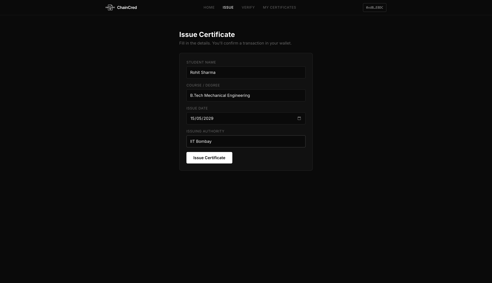
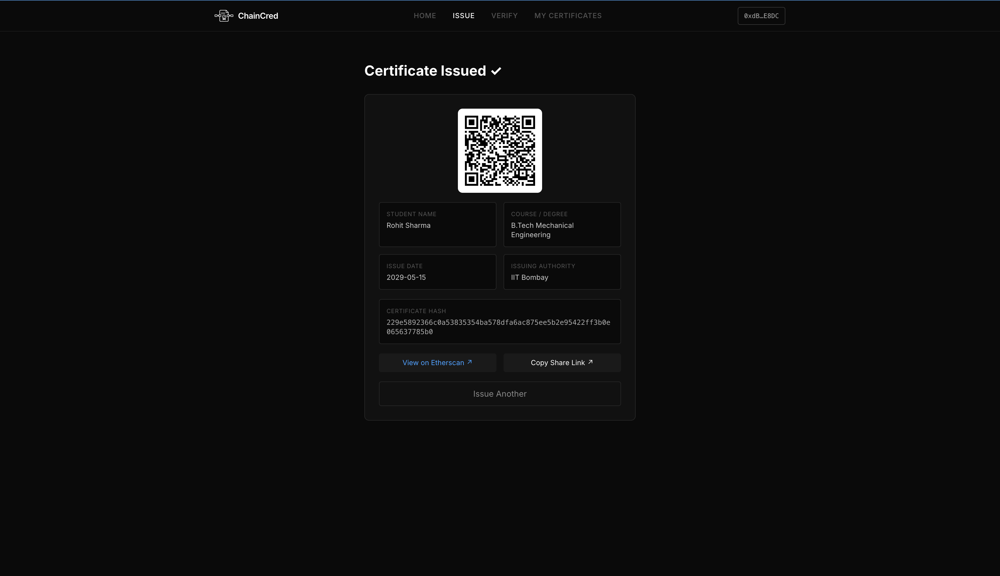
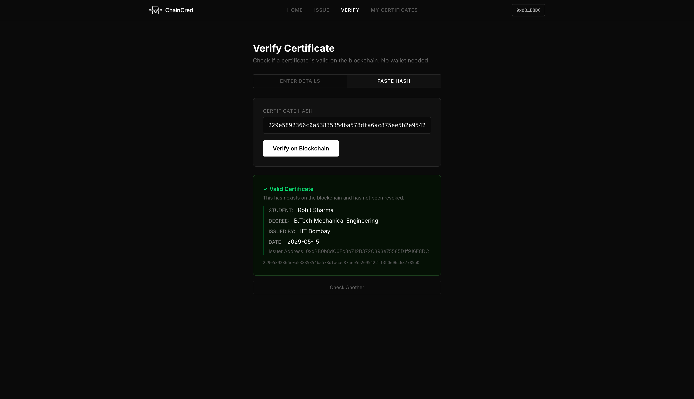
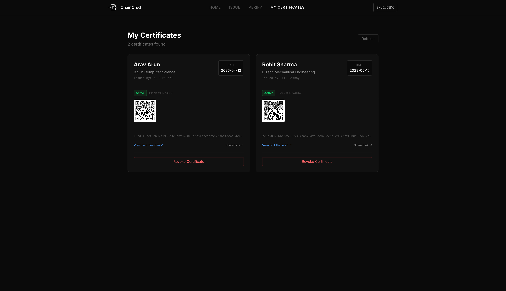
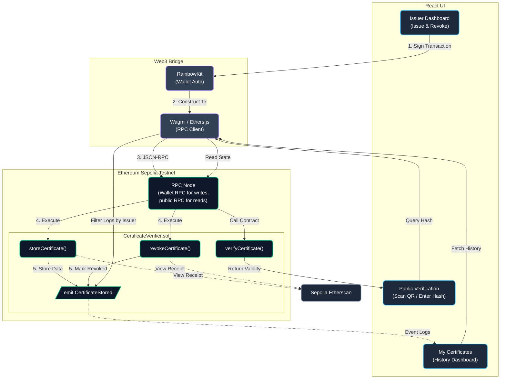

# ChainCred

- ChainCred is a decentralized platform for issuing, verifying, and managing academic and professional credentials on the Ethereum blockchain. It eliminates the friction and fraud associated with traditional paper certificates by creating an immutable, cryptographic record of achievement.
- Users interact with ChainCred through a sleek, modern React frontend. Institutions can connect their Web3 wallets to issue tamper-proof digital certificates directly on-chain. Once issued, students and employers can instantly verify the authenticity of a credential by scanning its QR code, opening its share link, pasting its certificate hash, or re-entering the certificate details, without relying on any centralized verification authority.
- The platform handles everything from certificate issuance to on-chain revocation and features a unified dashboard for issuers to manage their entire history. The source code is public on GitHub, and the contract is deployed on the Ethereum Sepolia Testnet.

## Screenshots

| Home Page | Issue Certificate |
| :---: | :---: |
|  |  |
| **Verify Certificate Form** | **Certificate Verified Success** |
|  |  |
| **My Certificates Dashboard** | |
|  | |

---

## Architecture

- **Issuer Application**: The institution connects via RainbowKit to sign transactions (Sepolia only; the app prompts a network switch if needed). The certificate fields (student name, course, date, issuing authority) are combined and hashed with SHA-256 in the browser.
- **Smart Contract Execution**: The contract stores only the hash → issuer address mapping in contract storage. The full certificate details are emitted in a gas-efficient `CertificateStored` event log rather than kept in storage. Event logs are public, so anyone can read the details of an issued certificate.
- **Verification Portal**: A public user scans a QR code, opens a share link, pastes a hash, or re-enters the certificate details. The frontend calls the contract through a public RPC node (no wallet needed) and shows whether the certificate is valid, revoked, or not found, along with its details.
- **History Dashboard**: When an issuer opens My Certificates (or presses Refresh), the frontend queries `CertificateStored` logs filtered by their wallet address and maps them into a human-readable dashboard.

---

## Key Features

- **Tamper-Proof Issuance**: Institutions can issue certificates that are permanently anchored to the Ethereum blockchain. Data is immutable and cannot be altered once confirmed.
- **Instant Cryptographic Verification**: Anyone can verify a credential in seconds using the certificate's unique hash, its share link, or by scanning its auto-generated QR code (which opens the verification page directly).
- **On-Chain Revocation**: If a certificate is issued in error or compromised, the issuing address has the exclusive authority to permanently mark the hash as revoked on-chain. Verifiers then see it as revoked.
- **My Certificates Dashboard**: A dashboard where issuers can view all their issued credentials, check live validity status (Active/Revoked), see the block each was issued in, and revoke certificates.
- **Zero Friction Wallet Connect**: Powered by RainbowKit, users can connect via MetaMask, Rainbow, Base Account (Coinbase), WalletConnect, and more with a single click.
- **Etherscan Integration**: 1-click links to view each issuance transaction and the contract directly on the Sepolia Etherscan block explorer.
- **Gas-Efficient Storage**: Instead of bloating contract storage, ChainCred keeps certificate details in Ethereum event logs (`emit CertificateStored`) and stores only the hash → issuer mapping and revocation flag on-chain.

---

## Why I built this

- Whether it’s university degrees or corporate certifications, the system is fundamentally broken: it’s either heavily reliant on vulnerable, easily forged paper documents or locked behind slow, centralized institutional databases that require manual phone calls and emails to verify.
- The moment I began diving into Ethereum and smart contracts, I realized that blockchain was the perfect infrastructure for this exact problem. By anchoring credentials on-chain, I could build a system where trust is decentralized and verification is instantaneous.
